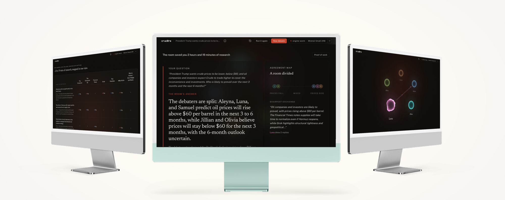

  

  
  
  

# You collected the research. Crucere reads it.

Be honest. That folder of PDFs, reports and spreadsheets? You haven't read it.

Nobody has. So, hand it over.

A room of five AI researchers reads every source. They show you where your sources agree, where they collide, and which ones never mention the thing at all. They suggest the questions worth asking. Then they argue it out, and a Judge rules on what was actually said.

You get the answer, the reasoning behind it, and a report you can hand to someone else. PDF, PowerPoint, audio or video. (The phone doesn't make the PDF yet.)

And all of it runs on your own computer. Nothing you upload or ask goes anywhere. No account. No sign-in. No cloud.

## Don't take my word for it

Here's what the room actually ruled. Real questions, real sources, nothing tidied up.

| The question | Research it saved |
| --- | --- |
| [The world has survived a brewing energy crisis for seven months. What should we watch next?](https://crucere.com/judgments/1790932590-dca5ad) | 32 hours, 5 minutes |
| [What is the difference between the dot-com boom and the AI boom?](https://crucere.com/judgments/1790269687-3b45f0) | 14 hours, 2 minutes |
| [Will the Fed Chair lower rates?](https://crucere.com/judgments/1790267642-4767fd) | 9 hours, 22 minutes |

Each one shows the answer, who argued what, and the sources it came from. There are [nine more](https://crucere.com/judgments) where those came from.

## Get it

| | Download | Runs on | Size |
| --- | --- | --- | --- |
| **Windows** | [Crucere-0.5.23-windows.exe](https://github.com/MichaelLisboa/crucere-releases/releases/download/v0.5.23/Crucere-0.5.23-windows.exe) | Windows 10 or 11, 64-bit | 176 MB |
| **Mac** | [Crucere-0.5.23-mac.pkg](https://github.com/MichaelLisboa/crucere-releases/releases/download/v0.5.23/Crucere-0.5.23-mac.pkg) | Apple silicon | 382 MB |
| **Android** | [Crucere-0.5.19-android.apk](https://github.com/MichaelLisboa/crucere-releases/releases/download/v0.5.19/Crucere-0.5.19-android.apk) | Android 12 or later | 133 MB |

Windows and Mac are on version 0.5.23. Android is still on 0.5.19, and catching up. It's an alpha. Things will break.

## The Windows one went on a diet

It was 1.7 GB. Now it's 176 MB.

Crucere needs something to run the AI models. On Windows and Mac that something is [Ollama](https://ollama.com), a free program. The Mac installer brings it along. The Windows one used to, whether you needed it or not.

Not anymore. On Windows, Crucere fetches Ollama the first time it opens, and only if you don't have it.

Already have Ollama? Crucere leaves yours alone.

Android doesn't use Ollama at all. It runs its own model, Google's Gemma, built to run directly on a phone.

## Your computer will complain

The installers aren't signed yet, so your device will ask if you're sure. You're sure.

- **Windows.** Run the file. If you see "Windows protected your PC", choose **More info**, then **Run anyway**.
- **Mac.** Right-click the file and choose **Open**. Still refusing? Go to **System Settings → Privacy & Security** and choose **Open Anyway**.
- **Android.** Open the file, and let your browser or file manager install apps when it asks.

## One more download

Sorry. Crucere fetches its AI model the first time it opens: about 2.5 GB on Windows and Mac, about 2.7 GB on Android. On Windows, add about 1.5 GB for Ollama if you don't have it.

Go make a coffee. After that, it works without an internet connection.

## It updates itself

On Windows, from 0.5.20. When there's a new version, a button shows up beside the version number. One click, and Crucere comes back on the new one.

Mac and Android don't do this yet. For those, you download the new installer.

## Something broke?

Good. That's what an alpha is for.

[Open an issue](https://github.com/MichaelLisboa/crucere-releases/issues) and tell me what happened. Questions, revelations and insults are all welcome.

Thanks for trying it.
